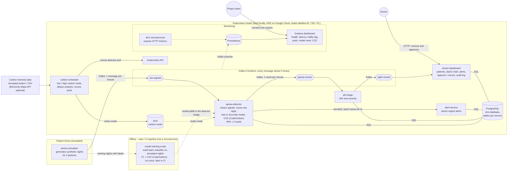
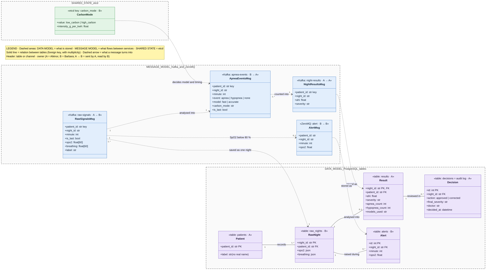
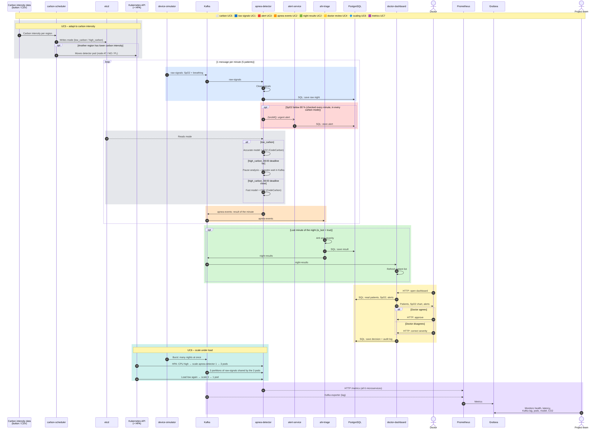

# Home Sleep Apnea Screening – a carbon-aware AI system on Kubernetes

Course project for **ACC1ILV – Cloud and AI Infrastructure**
Team: Barbara Klimek Tomatova, Aliénor Franck de Préaumont

📄 Project summary: [doc/Klimek_Préaumont_Project_summary.pdf](doc/Klimek_Préaumont_Project_summary.pdf) · 🧭 Decisions: [ADR/](ADR/README.md)

---

## What the project is about

**Situation.** People who might have sleep apnea often wait months for a night in a sleep lab. Instead, they could take a small device home that measures their oxygen level (SpO₂) and breathing during the night. In our project we simulate five patients.

**System.** The device data goes through Kafka (3 brokers, so one can fail) to an AI service that finds apnea events. Then we calculate the AHI (apnea-hypopnea index, events per hour) and sort the patient into *normal, mild, moderate* or *severe*. The doctor sees the results on a dashboard and approves each one. If the oxygen level drops too low, the doctor gets an alert right away.

**Why we chose this topic.** It is a real medical problem and easy to explain. The night analysis is not urgent, it only has to be ready by 08:00 in the morning. So the system can wait for electricity with lower CO₂ and choose between a fast and an accurate model. Alerts are the exception and always run immediately.

**Out of scope:** login for patients and doctors, sending reports to patients, therapy monitoring.

---

## Use cases

The actors are outside our system: the home device, the doctor, the external carbon intensity source and our team as operators. The carbon scheduler and Kubernetes are parts of the system, so they are not actors.

| # | Use case | Actor | Description |
| --- | --- | --- | --- |
| UC1 | Upload night recording | Home device (simulated) | The device sends the SpO₂ and breathing data of a night minute by minute. Each patient sends several nights. The raw night is saved. |
| UC2 | Screen night | Carbon intensity source (secondary) | The system finds apnea events, calculates the AHI and severity and saves the result. The carbon mode decides when the analysis runs (before 08:00) and if the fast or the accurate model is used. The CO₂ of each analysis is measured. |
| UC3 | Raise urgent alert – `<<extend>>` UC2 | Doctor | Only when SpO₂ goes below 80 %: the doctor gets an alert right away. Alerts never wait for low-carbon electricity. |
| UC4 | Review & approve result | Doctor | The doctor sees the patients sorted by severity, opens a report with the SpO₂ chart and the AHI trend over the patient's previous nights, and approves or corrects the result. Every decision is logged. |
| UC5 | Adapt to carbon intensity | Carbon intensity source | When the (simulated) carbon intensity changes, the system changes its behaviour: it delays the analysis, switches between the fast and the accurate model, lowers the maximum number of detector pods and moves the detector to a node in a cleaner (simulated) region (AT / NO / PL). |
| UC6 | Monitor system & footprint | Operator / Team | The team sees the system health (latency, Kafka lag, pods) and the AI behaviour (model used, confidence, events per hour, CO₂ per night). It gets a warning when the model drifts or its confidence drops. |
| UC7 | Retrain model | Operator / Team, Carbon intensity source | The team starts a new training of the AI model. The training runs only in a low-carbon window, the new model version is used only if its F1 score is above our threshold. |

**Non-functional requirements**

- **Scalability:** when many nights arrive at the same time, Kubernetes scales the apnea-detector from 1 to 3 pods and back (this was UC6 "Scale under load" before; it is a quality requirement, not a use case).
- **Alert latency:** an urgent alert reaches the doctor within 5 seconds, in every carbon mode.
- **Deadline:** every night is analysed before 08:00.
- **No data loss:** a night is not lost when a service or one Kafka broker stops.
- **Measured footprint:** the CO₂ of every analysis and training is measured with CodeCarbon (only the energy inside the containers).

---

## Component diagram



Zoomable version: [diagrams/30.10_B_component-diagram_v3.md](diagrams/30.10_B_component-diagram_v3.md)

The flow of one night: `device-simulator` → **raw-signals** → `apnea-detector` → **apnea-events** → `ahi-triage` → **night-results** → `doctor-dashboard`.

### Microservices

We have six microservices. The device-simulator stands for the patients' homes, the other five run in Kubernetes.

| Microservice | Use cases | What it does | Its data | Owner |
| --- | --- | --- | --- | --- |
| `device-simulator` | UC1, UC6 | Creates one night of SpO₂ and breathing data for each of the 5 patients and sends it to Kafka (one message per minute). A burst mode sends many nights at once for the scaling demo. | – (synthetic data) | Aliénor |
| `apnea-detector` | UC1, UC2, UC3, UC5, UC6 | Reads `raw-signals`, cleans the data and saves the raw night. Finds apnea events with the fast or the accurate model (chosen by the carbon mode), measures CO₂ with CodeCarbon and sends one `apnea-events` message per minute. A separate alert check (own consumer group, never paused) sends a ZeroMQ alert if SpO₂ < 80 %. Scales 1 → 3 pods. | PostgreSQL: `raw_nights` | Barbara |
| `ahi-triage` | UC2 | Counts the events of a night. After the last minute it calculates the AHI and severity, saves the result and sends `night-results`. | PostgreSQL: `results` | Aliénor |
| `alert-service` | UC3 | Gets urgent alerts over ZeroMQ and saves them for the dashboard. | PostgreSQL: `alerts` | Barbara |
| `doctor-dashboard` | UC3, UC4 | Shows the patients sorted by severity, SpO₂ charts and alerts. The doctor approves or corrects each result; every decision goes into the audit log. | PostgreSQL: `decisions` (audit log) | Aliénor |
| `carbon-scheduler` | UC5 | Reads the (simulated) carbon intensity, sets `low_carbon` or `high_carbon` mode in etcd, delays the analysis until cleaner electricity (deadline 08:00) and moves the detector pod to a cleaner node (AT / NO / PL). | etcd: carbon mode | Barbara |

**AI model:** the AI model is not a separate microservice. It is part of the `apnea-detector`, which loads a scikit-learn model (`models/model.joblib`, path from `MODEL_PATH`). We train it beforehand with a training script on simulated nights; the script prints the F1 score and the CO₂ of the training.

### Other components

| Component | Why we need it |
| --- | --- |
| **Kafka** (3 brokers, KRaft) | Carries the three topics `raw-signals` (3 partitions), `apnea-events` and `night-results`. Every message is stored 3 times and kept 7 days, so a night can wait for low-carbon electricity and one broker can fail without data loss. Message key = `patient_id`. |
| **ZeroMQ** | Direct, fast channel for urgent alerts, so they never wait in a queue. |
| **etcd** | Stores the current carbon mode (`/sleep-apnea/carbon_mode`). The scheduler writes it, the detector reads it – the detector keeps working even if the scheduler is down. |
| **PostgreSQL** | One database with 5 tables; each table is written by only one service. |
| **Kubernetes** | kind locally, GKE Standard on Google Cloud. Nodes are labelled AT / NO / PL (simulated regions). The HPA scales the apnea-detector from 1 to 3 pods. |
| **Prometheus + Grafana** | All services expose `/metrics`; with the Kafka exporter we see health, latency, Kafka lag, pods, the model used and CO₂. |
| **GitHub Actions** | Tests, builds the images and pushes them to Artifact Registry. |

---

## Data model and message model



Zoomable version: [diagrams/30.10_B_data-message-model_v1.md](diagrams/30.10_B_data-message-model_v1.md)

We only need five simple tables in one PostgreSQL database (`patients`, `raw_nights`, `results`, `alerts`, `decisions`), and each table is written by just one service. Patients have a label (e.g. *Patient 1*), no real name. Between the services we send four kinds of messages: three over Kafka (`raw-signals`, `apnea-events`, `night-results`) and the alert over ZeroMQ.

---

## Sequence diagram – one night end to end (UC1–UC7)



Zoomable version: [diagrams/30.10_B_sequence-diagram_v2.md](diagrams/30.10_B_sequence-diagram_v2.md)

The night comes in minute by minute: the apnea-detector checks every minute for a dangerous SpO₂ drop, and the carbon mode decides if it runs the accurate model, pauses the analysis or uses the fast model close to 08:00. After the last minute, ahi-triage calculates the AHI and the doctor approves or corrects it, and when many nights come at once Kubernetes scales the detector from 1 to 3 pods.

---

## Repository structure

```
ADR/        architecture decision records (in the order we made them)
diagrams/   component, data/message model and sequence diagrams (.mmd source, .png, .md to zoom)
doc/        project summary (PDF)
```

Older diagram versions (`24.10_A_…_v1`, `27.10_B_…_v2`, `30.10_sequence_diagram`) are kept to show how the design changed; the `30.10_B_*` files are the current ones.

## Status

Design phase: use cases, architecture, data model and decisions are done. Next: Kafka locally (docker-compose), then the services.
