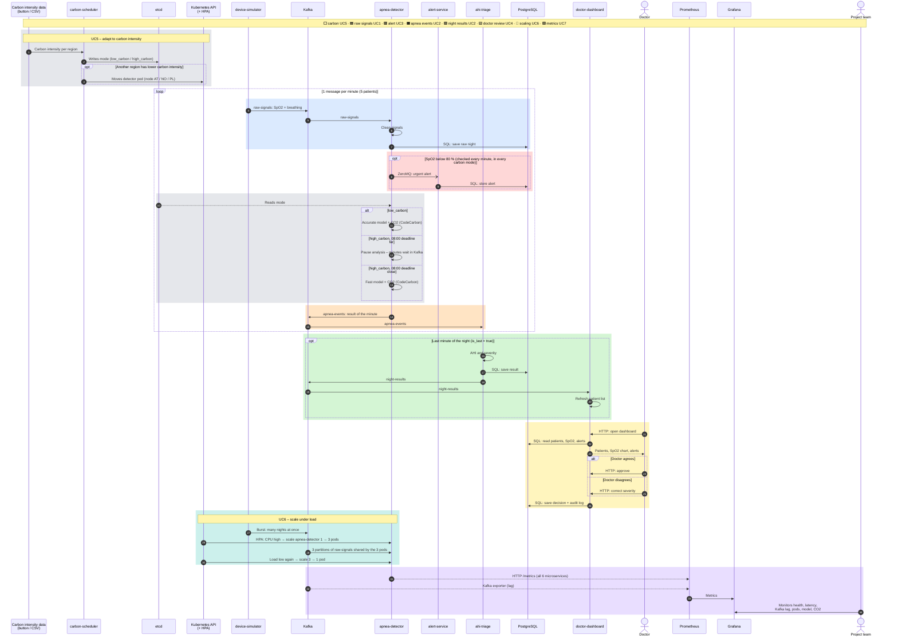

# Sequence diagram v2 – one night end to end (UC1–UC7)

Updated version of [30.10_sequence_diagram.mmd](30.10_sequence_diagram.mmd) (see ADR 0028). Source: [30.10_B_sequence-diagram_v2.mmd](30.10_B_sequence-diagram_v2.mmd) · Image: [30.10_B_sequence-diagram_v2.png](30.10_B_sequence-diagram_v2.png)

