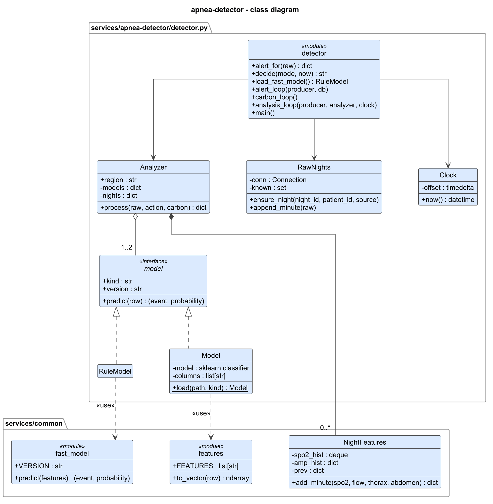
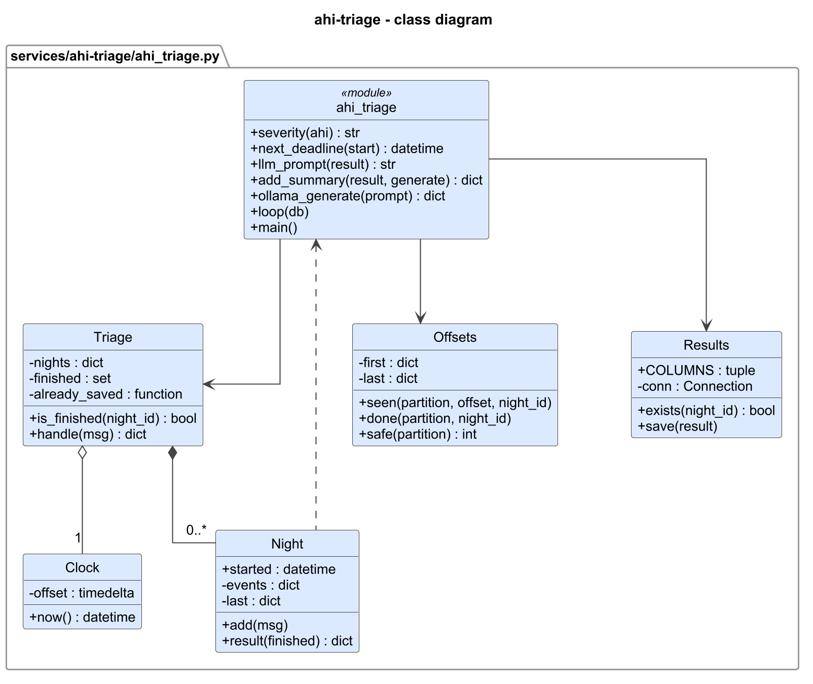
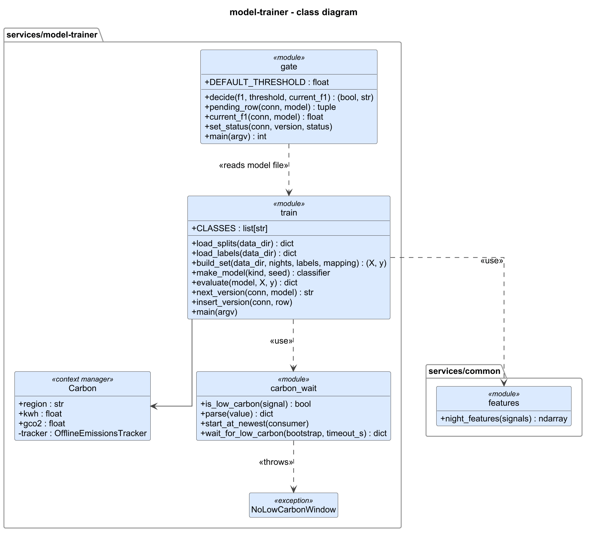

# Class diagrams

One class diagram per service, in PlantUML, standard UML notation: `+` public, `-` private,
filled diamond = composition, empty diamond = aggregation, dashed arrow with a hollow triangle =
implements an interface, dashed arrow = uses. Our services are mostly functions, so each Python file
is drawn as a `<<module>>` class with its functions. What the services read and write (Kafka topics,
tables) is in the sequence diagrams.

| Service | Diagram | Owner |
|---|---|---|
| apnea-detector (with `services/common/features.py`) | [14.11_B_class-apnea-detector_v1.puml](14.11_B_class-apnea-detector_v1.puml) · [png](14.11_B_class-apnea-detector_v1.png) | Barbara |
| ahi-triage | [14.11_B_class-ahi-triage_v1.puml](14.11_B_class-ahi-triage_v1.puml) · [png](14.11_B_class-ahi-triage_v1.png) | Barbara |
| model-trainer (`train.py`, `gate.py`) | [14.11_B_class-model-trainer_v1.puml](14.11_B_class-model-trainer_v1.puml) · [png](14.11_B_class-model-trainer_v1.png) | Barbara |

