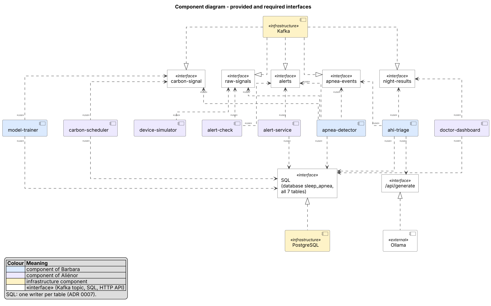
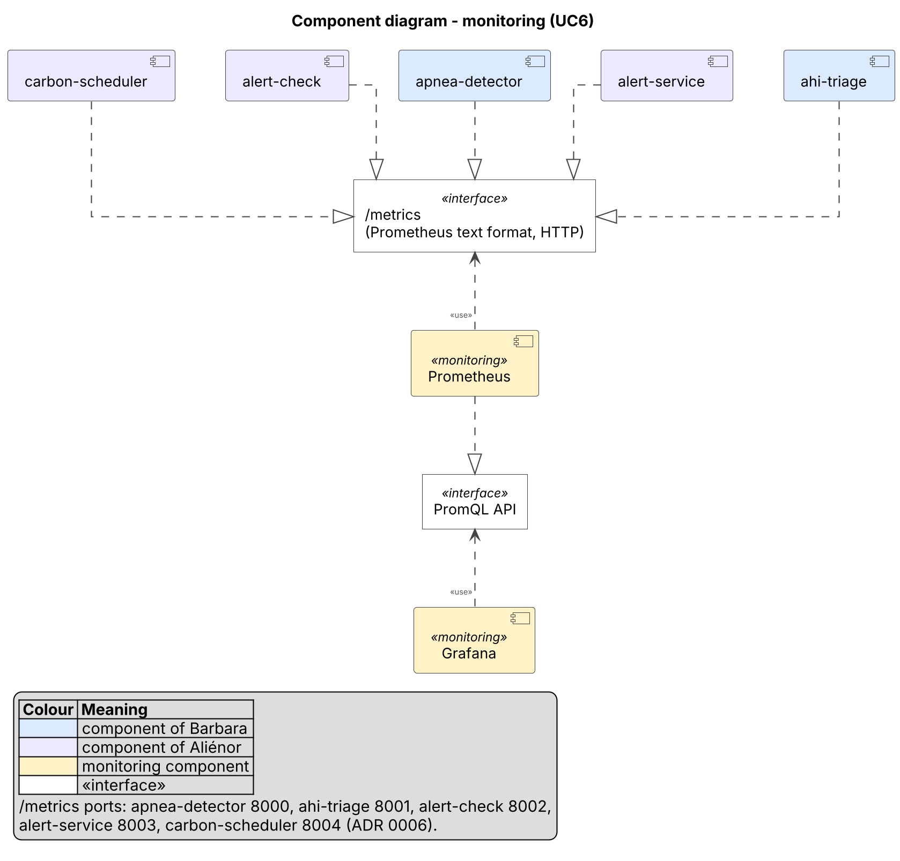

# Component diagram

Source (PlantUML): [24.11_B_component-diagram_v2.puml](24.11_B_component-diagram_v2.puml) · Image: [24.11_B_component-diagram_v2.png](24.11_B_component-diagram_v2.png)

UML notation with interfaces as «interface» classifiers: Kafka provides (realizes, dashed line with a
hollow triangle) one interface per topic, PostgreSQL the `SQL` interface and Ollama `/api/generate`;
every service requires («use» dependency, dashed arrow) the interfaces it sends to, reads from or writes.
Which table each service may write is in [ADR 0007](../../ADR/0007-one-postgresql-database-with-table-ownership.md). How the data flows through these interfaces is shown in the
[architecture overview](../overview/README.md).

Monitoring (UC6) has its own small component diagram, so the main one stays readable:
[24.11_B_component-diagram-monitoring_v1.puml](24.11_B_component-diagram-monitoring_v1.puml) ·
[png](24.11_B_component-diagram-monitoring_v1.png). Five services provide `/metrics`, Prometheus uses it,
Grafana uses the PromQL API of Prometheus ([ADR 0006](../../ADR/0006-monitoring-system-and-ai-behaviour.md)).

The **logical view** of the 4+1 model (and the Containers / Components level of C4): all services, the
interfaces between them and who owns what.

| Interface | Kind | Sends / writes / offers | Reads / calls |
| --- | --- | --- | --- |
| `raw-signals` | Kafka topic | device-simulator | apnea-detector (groups `apnea-detector`, `apnea-alerts`), alert-check |
| `apnea-events` | Kafka topic | apnea-detector | ahi-triage |
| `night-results` | Kafka topic | ahi-triage | doctor-dashboard |
| `alerts` | Kafka topic | alert-check, apnea-detector | alert-service |
| `carbon-signal` | Kafka topic | carbon-scheduler | apnea-detector, model-trainer (`carbon_wait.py`) |
| SQL, one writer per table ([ADR 0007](../../ADR/0007-one-postgresql-database-with-table-ownership.md)) | PostgreSQL | – | every service writes only its own table, all can read |
| `/api/generate` | HTTP | Ollama (local LLM, [ADR 0009](../../ADR/0009-llm-summary-with-a-local-model.md)) | ahi-triage |
| `/metrics` (ports 8000–8004) | HTTP | apnea-detector, ahi-triage, alert-check, alert-service, carbon-scheduler | Prometheus → Grafana |
| `services/common` (`features.py`, `fast_model.py`) | Python library | – | apnea-detector, model-trainer ([ADR 0008](../../ADR/0008-one-feature-code-for-training-and-live.md)) |
| `models/model.joblib` | file | model-trainer | apnea-detector |

The JSON Schema of every topic is in [`kafka/schemas/`](../../kafka/schemas/). The alert path
(`raw-signals` → alert-check → `alerts` → alert-service) never waits for low carbon
([ADR 0002](../../ADR/0002-separate-alert-path-that-never-waits.md)).

