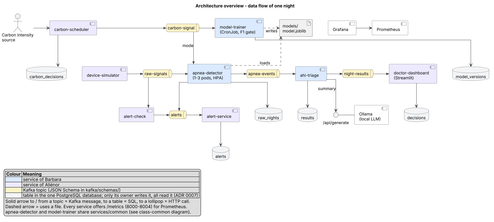

# Architecture overview – data flow

Source (PlantUML): [24.11_B_data-flow_v1.puml](24.11_B_data-flow_v1.puml) · Image: [24.11_B_data-flow_v1.png](24.11_B_data-flow_v1.png)

How one night moves through the system: `device-simulator` → **raw-signals** → `apnea-detector` →
**apnea-events** → `ahi-triage` → **night-results** → `doctor-dashboard`. Below it the alert path
(`raw-signals` → `alert-check` → **alerts** → `alert-service`), which never waits for low carbon
([ADR 0002](../../ADR/0002-separate-alert-path-that-never-waits.md)). Above it the carbon path:
`carbon-scheduler` → **carbon-signal** → `apnea-detector` (pause, fast or accurate model, [ADR 0003](../../ADR/0003-carbon-aware-strategy.md))
and `model-trainer` (training only in a low-carbon window, [ADR 0005](../../ADR/0005-model-lifecycle-carbon-aware-retraining.md)).
Every table is drawn under the only service that writes it ([ADR 0007](../../ADR/0007-one-postgresql-database-with-table-ownership.md)).

4+1 view: **Process** (together with the sequence diagrams). C4 level: **Container**.
The formal UML component diagram with provided and required interfaces is in [`../components/`](../components/README.md).

