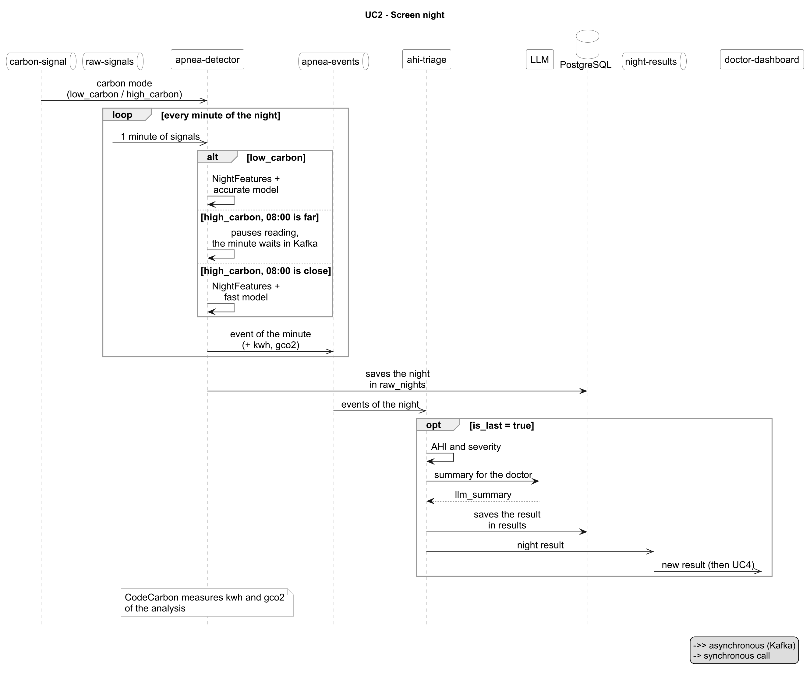

# UC2 – Screen night

Use cases overview: [README](../../README.md#use-cases) · Source (PlantUML): [10.11_A_UC2-analyse-a-night_v1.puml](10.11_A_UC2-analyse-a-night_v1.puml) · Image: [10.11_A_UC2-analyse-a-night_v1.png](10.11_A_UC2-analyse-a-night_v1.png)

| | |
| --- | --- |
| **Actors** | System; Carbon intensity source (secondary, through UC5) |
| **Goal** | Find apnea events, calculate the AHI and the severity of the night, write a short summary for the doctor and measure the CO₂ of the analysis. |
| **Trigger** | `raw-signals` messages of a night arrive (UC1). |
| **Precondition** | The model file `models/model.joblib` is in the detector image. The carbon-scheduler sends the carbon mode to `carbon-signal` (UC5). |
| **Services** | `apnea-detector`, `ahi-triage`, `doctor-dashboard` |
| **Data** | Kafka `raw-signals` → table `raw_nights` → Kafka `apnea-events` → table `results` → Kafka `night-results` (schemas in [`kafka/schemas/`](../../kafka/schemas/)) |
| **Decisions** | [ADR 0001](../../ADR/0001-kafka-as-a-buffer-for-time-shifting.md), [ADR 0003](../../ADR/0003-carbon-aware-strategy.md), [ADR 0005](../../ADR/0005-model-lifecycle-carbon-aware-retraining.md), [ADR 0007](../../ADR/0007-one-postgresql-database-with-table-ownership.md) |

## Main flow
1. The `apnea-detector` reads the carbon mode from `carbon-signal` (`low_carbon` / `high_carbon`).
2. It reads the night minute by minute from `raw-signals` and computes the features of each minute (`NightFeatures`, only past data).
3. It classifies the minute with the **accurate** model (low carbon) or the **fast** model. CodeCarbon measures `kwh` and `gco2`.
4. It sends one `apnea-events` message per minute: `night_id`, `minute`, `event` (apnea / hypopnea / none), `probability`, `model`, `carbon_mode`, `is_last`.
5. At the end of the night it saves the whole night in `raw_nights` (for the SpO₂ chart in UC4 and for UC7).
6. `ahi-triage` reads `apnea-events` and counts the events of the night.
7. When `is_last = true`, it calculates the **AHI** = (apneas + hypopneas) / hours of sleep and the severity:
   normal < 5 · mild 5–15 · moderate 15–30 · severe ≥ 30 events per hour.
8. It asks the LLM for a short summary for the doctor (`llm_summary`, `llm_gco2`).
9. It saves the result in `results` (`ahi`, `severity`, `event_count`, `model`, `model_version`, `carbon_mode`, `region`, `kwh`, `gco2`, `deadline_met`, `llm_summary`).
10. It sends `night-results`. The `doctor-dashboard` reads it and shows the new result (then UC4).

## Alternative flows
- **A1 – high_carbon, 08:00 is far:** the detector pauses reading. The minutes wait in Kafka (7 days retention) until `low_carbon` (UC5).
- **A2 – high_carbon, 08:00 is close:** the fast model is used, so the result is ready by 08:00 (`deadline_met = true`).
- **A3 – `ahi-triage` restarts during the night:** it continues from its last Kafka offset, no event is lost.
- **A4 – the LLM does not answer:** the result is saved without `llm_summary`, the doctor still sees AHI and severity.
- **A5 – SpO₂ < 80 %:** the urgent alert runs in parallel and is never paused (UC3, `<<extend>>`).

## Postcondition
The night is saved in `raw_nights`, its result with AHI, severity, summary and CO₂ is in `results`, and the dashboard shows it to the doctor.

## Sequence diagram (PlantUML)

