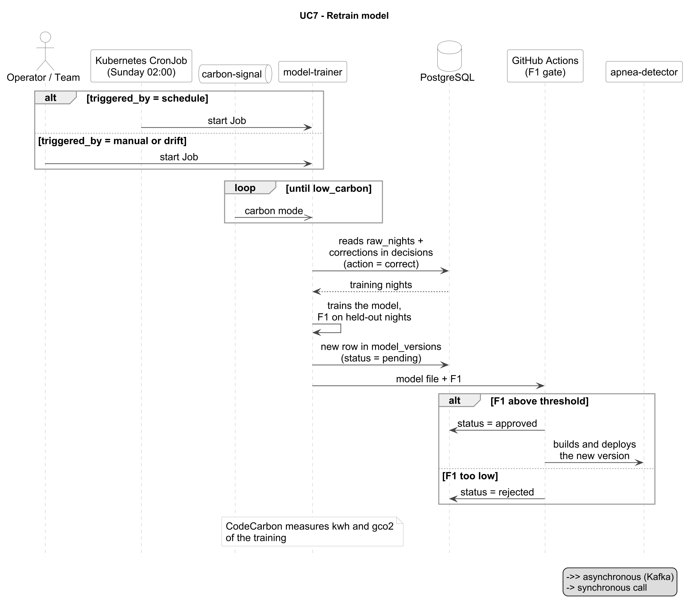

# UC7 – Retrain model

Use cases overview: [README](../../README.md#use-cases) · Source (PlantUML): [10.11_B_UC7-retrain-model_v1.puml](10.11_B_UC7-retrain-model_v1.puml) · Image: [10.11_B_UC7-retrain-model_v1.png](10.11_B_UC7-retrain-model_v1.png)

| | |
| --- | --- |
| **Actors** | Operator / Team; Carbon intensity source (secondary, through UC5) |
| **Goal** | Train a new version of the AI model on new nights and doctor corrections, at a low-carbon time, and use it only if it is better. |
| **Trigger** | `triggered_by` = `schedule` (Kubernetes CronJob, Sunday 02:00), `manual` (the team) or `drift` (warning from UC6). |
| **Precondition** | Nights are saved in `raw_nights` (UC2). Doctor corrections are in `decisions` (UC4). |
| **Services** | `model-trainer` (Kubernetes Job), GitHub Actions, `apnea-detector` |
| **Data** | `raw_nights` + `decisions` → `model_versions` → model file `models/model.joblib` |
| **Decisions** | [ADR 0005](../../ADR/0005-model-lifecycle-carbon-aware-retraining.md), [ADR 0003](../../ADR/0003-carbon-aware-strategy.md), [ADR 0007](../../ADR/0007-one-postgresql-database-with-table-ownership.md) |

## Main flow
1. The CronJob (or the team) starts the `model-trainer` Job.
2. The trainer reads `carbon-signal` and waits until the mode is `low_carbon`.
3. It reads the nights from `raw_nights` and the doctor corrections from `decisions` (`action = correct`).
4. It trains the model and measures F1, precision and recall on held-out Apnea-ECG nights. CodeCarbon measures `kwh` and `gco2`.
5. It saves a new row in `model_versions` with `status = pending`, `train_nights`, `doctor_corrections_used` and `triggered_by`.
6. GitHub Actions checks the F1 score (F1 gate).
7. F1 is above the threshold: `status = approved`, the new image is built and the `apnea-detector` is deployed with the new version.

## Alternative flows
- **A1 – F1 too low:** `status = rejected`, the old model stays in use.
- **A2 – no low-carbon window before the deadline of the Job:** the Job stops, nothing changes, the next run tries again.
- **A3 – the Job fails during training:** no row is `approved`, the old model stays in use.

## Postcondition
A new row in `model_versions` with F1 and CO₂. If it is `approved`, every new result in `results` stores this `model_version`.

## Sequence diagram (PlantUML)

