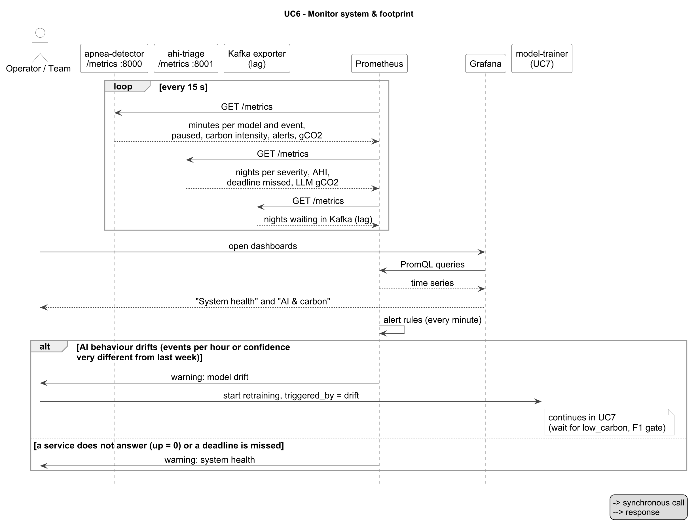

# UC6 – Monitor system & footprint

Use cases overview: [README](../../README.md#use-cases) · Source (PlantUML): [22.11_B_UC6-monitor-system-and-footprint_v1.puml](22.11_B_UC6-monitor-system-and-footprint_v1.puml) · Image: [22.11_B_UC6-monitor-system-and-footprint_v1.png](22.11_B_UC6-monitor-system-and-footprint_v1.png)

| | |
| --- | --- |
| **Actor** | Operator / Team |
| **Goal** | See that the system works and the SLOs hold, see how the AI model behaves and how much CO₂ the system uses, and get a warning when something is wrong. |
| **Trigger** | Continuous (Prometheus scrapes every 15 s); the team opens Grafana; an alert rule fires. |
| **Precondition** | The services expose `/metrics` (apnea-detector 8000, ahi-triage 8001, Aliénor's services), Prometheus and Grafana run in the cluster. |
| **Services** | `apnea-detector`, `ahi-triage`, Kafka exporter, Prometheus, Grafana, `model-trainer` (UC7) |
| **Data** | Prometheus time series (short retention); no new table |
| **Decisions** | [ADR 0006](../../ADR/0006-monitoring-system-and-ai-behaviour.md), ADR 0010 how we measure CO₂ (to do), [ADR 0005](../../ADR/0005-model-lifecycle-carbon-aware-retraining.md) |

## Main flow
1. Every 15 s Prometheus reads `/metrics` of the services and the Kafka exporter:
   - apnea-detector: `detector_minutes_total` (per model and event), `detector_paused`, `detector_carbon_intensity`, `detector_alerts_total`, `detector_gco2_total`
   - ahi-triage: `triage_nights_total` (per severity), `triage_ahi`, `triage_open_nights`, `triage_deadline_missed_total`, `triage_llm_gco2_total`, `triage_llm_failed_total`
   - Kafka exporter: consumer lag = nights waiting in Kafka
2. The team opens Grafana. Grafana asks Prometheus (PromQL) and shows two dashboards:
   - **System health:** services up, Kafka lag, pods, alert latency, deadlines missed
   - **AI & carbon:** model used (accurate / fast), events per hour, severity of the nights, gCO₂ per night and per LLM summary, carbon mode and region
3. Prometheus checks its alert rules every minute.

## Alternative flows
- **A1 – the AI behaviour drifts:** the share of event minutes per night or the average confidence of the model is very different from last week. Prometheus warns the team. Drift is only a sign, so the team decides and starts a retraining with `triggered_by = drift` (UC7).
- **A2 – system health:** a service does not answer (`up = 0`), the Kafka lag keeps growing or a night misses 08:00 (`triage_deadline_missed_total`). Prometheus warns the team.

## Postcondition
The team sees the state of the system, of the AI and of the CO₂; warnings lead to an action (UC7 or a fix).

The confidence of the model is the histogram `detector_confidence{model}` of the apnea-detector (for A1).
A1 is in [`monitoring/prometheus/rules/ai-and-carbon.yml`](../../monitoring/prometheus/rules/ai-and-carbon.yml): `ApneaEventShareDrift`
(share of event minutes changed by > 50 % against last week), `ModelConfidenceDrift` (average confidence moved by > 0.1 against last week)
and `ModelLowConfidence` (> 30 % of the minutes below 0.7). The dashboard **AI & carbon** is
[`monitoring/grafana/dashboards/ai-and-carbon.json`](../../monitoring/grafana/dashboards/ai-and-carbon.json).
**Still to do:** Prometheus, Grafana and the Kafka exporter in the K8s base, the dashboard "System health" and the A2 rules.

## Sequence diagram (PlantUML)

