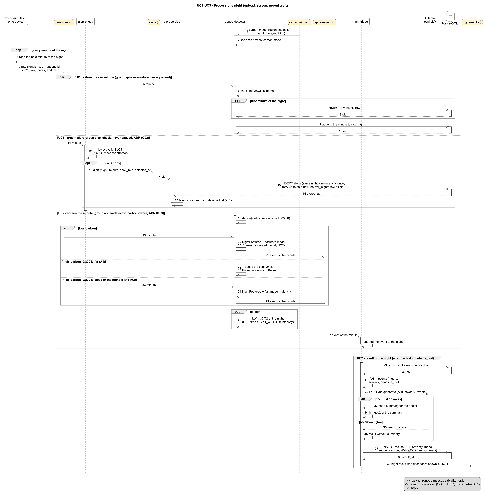

# UC1–UC3 – Process one night

Use cases overview: [README](../../README.md#use-cases) · All sequence diagrams: [README](README.md) · Source (PlantUML): [AB_UC1-UC3_process-one-night.puml](AB_UC1-UC3_process-one-night.puml) · Image: [AB_UC1-UC3_process-one-night.png](AB_UC1-UC3_process-one-night.png)

UC1, UC2 and UC3 work on the same `raw-signals` minutes at the same time, so they are drawn in one
sequence diagram. Every minute goes to three independent consumer groups (the `par` fragment):
UC1 stores it, UC3 checks it for an urgent alert, UC2 analyses it. UC3 `<<extend>>` UC2.
The step numbers below are the numbers in the diagram.

| | |
| --- | --- |
| **Actors** | Home device (simulated by `device-simulator`) – UC1; Doctor – UC3; Carbon intensity source (secondary, through UC5) – UC2 |
| **Trigger** | The simulator starts a night of a patient (or many nights at once in burst mode). |
| **Precondition** | Kafka and PostgreSQL run; the topics exist; the carbon-scheduler sends `carbon-signal` (UC5); an approved model is in `model_versions` (UC7) or the start model is in the detector image. |
| **Services** | `device-simulator`, `apnea-detector`, `alert-check`, `alert-service`, `ahi-triage`, Ollama |
| **Data** | Kafka `raw-signals` → `raw_nights`; `raw-signals` → `alerts` → table `alerts`; `raw-signals` → `apnea-events` → `results` → `night-results` (schemas in [`kafka/schemas/`](../../kafka/schemas/)) |
| **Decisions** | [ADR 0001](../../ADR/0001-kafka-as-a-buffer-for-time-shifting.md), [ADR 0002](../../ADR/0002-separate-alert-path-that-never-waits.md), [ADR 0003](../../ADR/0003-carbon-aware-strategy.md), [ADR 0007](../../ADR/0007-one-postgresql-database-with-table-ownership.md), [ADR 0008](../../ADR/0008-one-feature-code-for-training-and-live.md), [ADR 0009](../../ADR/0009-llm-summary-with-a-local-model.md) |

## Before the night (steps 1–2)
The `apnea-detector` reads `carbon-signal` and keeps the newest carbon mode and region (sent by UC5 whenever they change).

## UC1 – Upload night recording (steps 3–10)
1. **3–4:** every minute the `device-simulator` reads the next minute of the night and sends one `raw-signals` message (key = `patient_id`): `spo2[60]`, `flow[240]`, `thorax[240]`, `abdomen[240]`, `minute`, `is_last`, no labels.
2. **5–6:** the `apnea-detector` reads it with its own consumer group `apnea-raw-store`, which is **never paused**, and checks the JSON schema.
3. **7–8:** at the first minute of the night it creates the `raw_nights` row (the alerts of the night point to it).
4. **9–10:** it appends the minute to `raw_nights`, so the night is complete even while the analysis waits for low carbon.

**Alternative flows**
- **A1 – the detector is down:** the minutes wait in Kafka and are read later (ADR 0001).
- **A2 – the message does not match the JSON schema:** it is logged and skipped.

## UC3 – Raise urgent alert (steps 11–17), `<<extend>>` UC2
1. **11–12:** `alert-check` reads the same minute with its own consumer group `alert-check`, never paused, in every carbon mode. It takes the lowest valid SpO₂ (values < 50 % are sensor artefacts).
2. **13:** if SpO₂ < 80 %, it sends an `alerts` message: `night_id`, `minute`, `spo2_min`, `detected_at`. `alert-check` is the only service that sends alerts (one alert path, ADR 0002).
3. **14–16:** `alert-service` reads `alerts` and inserts the alert into the table `alerts` (the same night and minute only once). If the `raw_nights` row does not exist yet, it retries for up to 60 s.
4. **17:** it measures the alert latency `stored_at − detected_at` (goal < 5 s, in `/metrics`). The doctor sees the alert on the dashboard (UC4).

**Alternative flows**
- **A1 – SpO₂ ≥ 80 %:** no alert.
- **A2 – `alert-service` is down:** the alert waits in the topic `alerts`, no alert is lost.

## UC2 – Screen night (steps 18–39)
1. **18:** the analysis (consumer group `apnea-detector`) decides from the carbon mode and the time until 08:00: accurate model, fast model or pause (ADR 0003).
2. **19–21 (`low_carbon`):** it reads the minute, computes the features (`NightFeatures`, only past data) and classifies the minute with the newest approved accurate model (UC7). It sends one `apnea-events` message per minute.
3. **26:** at the last minute (`is_last`) it adds `kwh` and `gco2` of the whole night (CPU time × `CPU_WATTS` × carbon intensity of the region).
4. **27–28:** `ahi-triage` reads `apnea-events` and adds each event to its night.
5. **29–30:** after the last minute it checks that the night is not already in `results` (Kafka can deliver twice).
6. **31:** it calculates **AHI** = minutes with an event / hours of recording, the severity (normal < 5 · mild 5–15 · moderate 15–30 · severe ≥ 30) and `deadline_met` (before 08:00).
7. **32–34:** it asks the local LLM (Ollama, `/api/generate`) for a short summary for the doctor and estimates its `llm_gco2`.
8. **37–38:** it saves the result in `results`.
9. **39:** it sends `night-results`. The doctor reviews the result in UC4.

**Alternative flows**
- **A1 – `high_carbon`, 08:00 is far (step 22):** the detector pauses its consumer; the minutes wait in Kafka until `low_carbon` or until 08:00 is close.
- **A2 – `high_carbon`, 08:00 is close or the night is late (steps 23–25):** the fast model (`rule-v1`) is used, so the result is ready by 08:00.
- **A3 – `ahi-triage` restarts during the night:** it continues from its last safe Kafka offset, no event is lost.
- **A4 – the LLM does not answer (steps 35–36):** the result is saved without `llm_summary`; the doctor still sees AHI and severity.

## Postcondition
The night is in `raw_nights`, every urgent alert is in `alerts` within seconds, and the result with AHI, severity, summary and CO₂ is in `results`.

## Implementation status
- **In the code:** device-simulator, `alert-check`, `alert-service`, the carbon-aware analysis (accurate / fast / pause), the CO₂ estimate, `ahi-triage` with the LLM summary.
- **To do so that the code matches this diagram:**
  - the apnea-detector still has its own alert loop (consumer group `apnea-alerts`) that also sends to `alerts`. It has to become a store loop that only saves `raw_nights` (group `apnea-raw-store`), so `alert-check` is the only alert path;
  - the detector still uses only the model built into its image; it has to load the newest approved model from `model_versions` (see UC7).

## Sequence diagram

