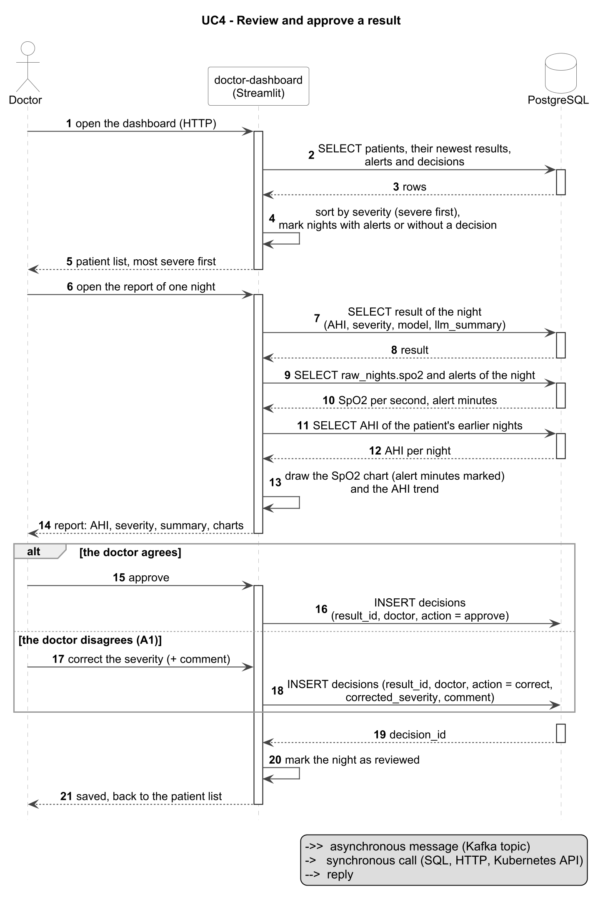

# UC4 – Review and approve a result

Use cases overview: [README](../../README.md#use-cases) · All sequence diagrams: [README](README.md) · Source (PlantUML): [A_UC4-review-a-result.puml](A_UC4-review-a-result.puml) · Image: [A_UC4-review-a-result.png](A_UC4-review-a-result.png)

| | |
| --- | --- |
| **Actor** | Doctor |
| **Goal** | The doctor checks each result and approves or corrects it. Every decision is logged. |
| **Trigger** | The doctor opens the dashboard (new results arrive after UC2). |
| **Precondition** | The night has a result in `results` (UC1–UC3). |
| **Services** | `doctor-dashboard` (Streamlit) |
| **Data** | reads `patients`, `results`, `raw_nights`, `alerts`, `decisions`; writes `decisions` (audit log, owner Aliénor) |
| **Decisions** | [ADR 0007](../../ADR/0007-one-postgresql-database-with-table-ownership.md) |

The dashboard pulls everything it shows from PostgreSQL. It does not need a Kafka topic.

## Main flow (step numbers of the diagram)
1. **1–5:** the doctor opens the dashboard. It reads the patients with their newest results, alerts and decisions, sorts them by severity (severe first), marks nights with alerts or without a decision and shows the list.
2. **6–8:** the doctor opens the report of one night. The dashboard reads the result: AHI, severity, model used, LLM summary.
3. **9–10:** it reads the SpO₂ values of the night from `raw_nights` and the alert minutes from `alerts`.
4. **11–12:** it reads the AHI of the patient's earlier nights.
5. **13–14:** it draws the SpO₂ chart (alert minutes marked) and the AHI trend and shows the report.
6. **15–16:** the doctor approves; the dashboard inserts a row into `decisions`: `result_id`, `doctor`, `action = approve`.
7. **19–21:** the database returns the `decision_id`, the night is marked as reviewed and the doctor is back at the list.

## Alternative flows
- **A1 – the doctor disagrees (steps 17–18):** they correct the severity (and may add a comment); the row has `action = correct`, `corrected_severity` and `comment`. These corrections can be used for a later training (UC7).
- **A2 – a decision is changed later:** a new row is added to `decisions`; old rows are never changed (audit log).

## Out of scope
Login for doctors, sending the report to the patient.

## Postcondition
Every reviewed result has at least one row in `decisions`; the final severity is the doctor's.

## Sequence diagram

