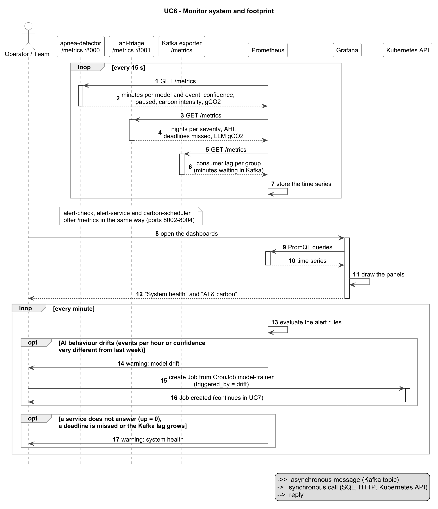

# UC6 – Monitor system and footprint

Use cases overview: [README](../../README.md#use-cases) · All sequence diagrams: [README](README.md) · Source (PlantUML): [B_UC6-monitor-system-and-footprint.puml](B_UC6-monitor-system-and-footprint.puml) · Image: [B_UC6-monitor-system-and-footprint.png](B_UC6-monitor-system-and-footprint.png)

| | |
| --- | --- |
| **Actor** | Operator / Team |
| **Goal** | The team sees the system health (services up, Kafka lag, pods, alert latency, deadlines) and the AI behaviour (model used, confidence, events per hour, CO₂ per night) and gets a warning when something goes wrong. |
| **Trigger** | Prometheus scrapes every 15 s; the team opens Grafana. |
| **Precondition** | The services expose `/metrics` (apnea-detector 8000, ahi-triage 8001, alert-check 8002, alert-service 8003, carbon-scheduler 8004); the Kafka exporter, Prometheus and Grafana run in the cluster. |
| **Services** | `apnea-detector`, `ahi-triage`, Kafka exporter, Prometheus, Grafana, Kubernetes API (UC7) |
| **Data** | Prometheus time series (short retention); no new table |
| **Decisions** | [ADR 0006](../../ADR/0006-monitoring-system-and-ai-behaviour.md), [ADR 0005](../../ADR/0005-model-lifecycle-carbon-aware-retraining.md) |

## Main flow (step numbers of the diagram)
1. **1–7:** every 15 s Prometheus reads `/metrics` and stores the time series:
   - apnea-detector: `detector_minutes_total` (per model and event), `detector_confidence`, `detector_paused`, `detector_carbon_intensity`, `detector_gco2_total`
   - ahi-triage: `triage_nights_total` (per severity), `triage_ahi`, `triage_open_nights`, `triage_deadline_missed_total`, `triage_llm_gco2_total`, `triage_llm_failed_total`
   - Kafka exporter: consumer lag per group = minutes waiting in Kafka
   - alert-check, alert-service and carbon-scheduler in the same way (note in the diagram)
2. **8–12:** the team opens Grafana. Grafana asks Prometheus (PromQL), draws the panels and shows two dashboards:
   - **System health:** services up, Kafka lag, pods, alert latency, deadlines missed
   - **AI & carbon:** model used (accurate / fast), events per hour, confidence, severity of the nights, gCO₂ per night and per LLM summary, carbon mode and region
3. **13:** every minute Prometheus evaluates its alert rules ([`monitoring/prometheus/rules/`](../../monitoring/prometheus/rules/)).

## Alternative flows
- **A1 – model drift (steps 14–16):** events per hour or confidence are very different from last week → warning; the team starts a training with `triggered_by = drift` (UC7).
- **A2 – system health (step 17):** a service does not answer (`up = 0`), a deadline is missed or the Kafka lag grows → warning.

## Postcondition
The team knows the state of the system and of the AI, and reacts to drift with a new training.

## Implementation status
- **In the code:** `/metrics` in apnea-detector, ahi-triage, alert-check, alert-service and carbon-scheduler; Prometheus rules with tests; the Grafana dashboard "AI & carbon".
- **To do so that the code matches this diagram:** the Kafka exporter (steps 5–6), Prometheus and Grafana in the cluster, the Grafana dashboard "System health".

## Sequence diagram

