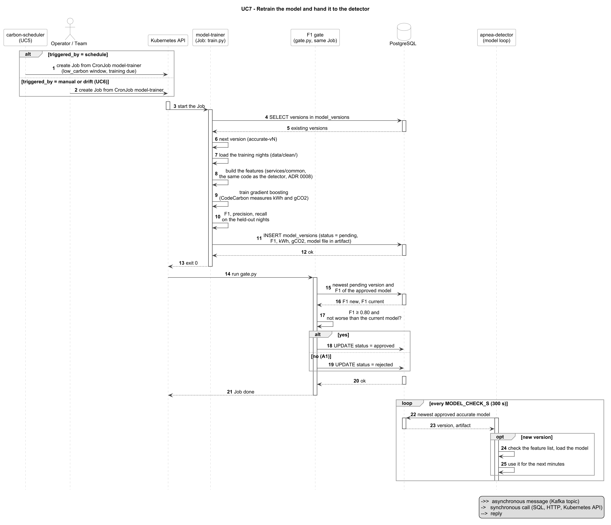

# UC7 – Retrain model

Use cases overview: [README](../../README.md#use-cases) · All sequence diagrams: [README](README.md) · Source (PlantUML): [B_UC7-retrain-model.puml](B_UC7-retrain-model.puml) · Image: [B_UC7-retrain-model.png](B_UC7-retrain-model.png)

| | |
| --- | --- |
| **Actors** | Operator / Team; Carbon intensity source (secondary, through UC5) |
| **Goal** | Train a new version of the AI model at a low-carbon time, use it only if it is good enough, and hand it to the detector without a new image. |
| **Trigger** | `triggered_by` = `schedule` (the carbon-scheduler in a low-carbon window, once a week, UC5), `manual` (the team) or `drift` (warning from UC6). |
| **Precondition** | The training data (`data/clean/`) is in the trainer image. |
| **Services** | `model-trainer` (Kubernetes Job: `train.py`, then `gate.py` in the same Job), `apnea-detector` (model loop) |
| **Data** | `data/clean/` → `model_versions` (metrics, CO₂, status and the model file in `artifact`) → `apnea-detector` |
| **Decisions** | [ADR 0005](../../ADR/0005-model-lifecycle-carbon-aware-retraining.md), [ADR 0008](../../ADR/0008-one-feature-code-for-training-and-live.md), [ADR 0007](../../ADR/0007-one-postgresql-database-with-table-ownership.md) |

## Main flow (step numbers of the diagram)
1. **1–3:** the carbon-scheduler (or the team) creates a Job from the CronJob `model-trainer`; Kubernetes starts it.
2. **4–6:** `train.py` reads the existing versions from `model_versions` and picks the next one (`accurate-vN`).
3. **7–10:** it loads the training nights, builds the features with `services/common` (the same code as the detector), trains the model (CodeCarbon measures `kwh` and `gco2`) and measures F1, precision and recall on held-out Apnea-ECG nights.
4. **11–13:** it inserts a row into `model_versions` with `status = pending`, the metrics, the CO₂ and the model file in `artifact`.
5. **14–17:** in the same Job `gate.py` compares the F1 with the threshold (0.80) and with the F1 of the approved model.
6. **18, 20–21:** F1 is good enough → `status = approved`.
7. **22–25:** every 300 s the model loop of the apnea-detector asks for the newest approved model. If it is new, it checks the feature list, loads it and uses it for the next minutes.

## Alternative flows
- **A1 – F1 too low (step 19):** `status = rejected`, the detector keeps the old model.
- **A2 – the Job fails during training:** no new row is `approved`, the old model stays in use; Kubernetes retries once.
- **A3 – the new model has other features than the detector:** the detector refuses it and keeps the old one.

The same F1 gate also runs in GitHub Actions on every change of the trainer code (CI).
Doctor corrections from `decisions` are not used for training yet (`doctor_corrections_used = 0`).

## Postcondition
A new row in `model_versions` with F1 and CO₂. If it is `approved`, the detector uses it within 5 minutes and every new result in `results` stores this `model_version`.

## Sequence diagram

