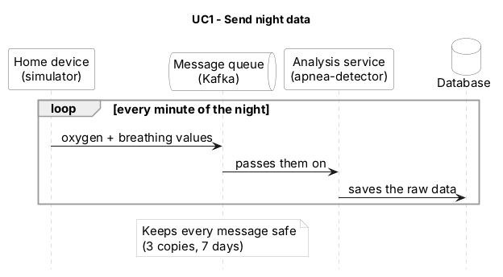

# UC1 – Send night data

Part of the [sequence diagram v2](../30.10_B_sequence-diagram_v2.md). Use cases overview: [README](../../README.md#use-cases). · Source (PlantUML): [10.11_A_UC1-send-night-data_v1.puml](10.11_A_UC1-send-night-data_v1.puml) · Image: [10.11_A_UC1-send-night-data_v1.png](10.11_A_UC1-send-night-data_v1.png)

| | |
| --- | --- |
| **Actor** | Device (`device-simulator`) |
| **Goal** | The SpO₂ and breathing data of one night arrives in the system and the raw night is saved. |
| **Trigger** | The simulator starts a night for one of the 5 patients (or many nights at once in burst mode, see UC6). |
| **Precondition** | Kafka (3 brokers) and PostgreSQL are running; topic `raw-signals` exists (3 partitions). |
| **Services** | `device-simulator`, `apnea-detector` |
| **Data** | Kafka topic `raw-signals` → PostgreSQL table `raw_nights` (owner B) |
| **Decisions** | ADR 0002, 0012, 0020, 0025, 0026 |

## Main flow
1. The `device-simulator` generates a synthetic night for a patient (ADR 0012).
2. Every minute it sends one `raw-signals` message to Kafka (key = `patient_id`):
   `patient_id`, `night_id`, `minute`, `is_last`, `spo2[60]`, `breathing[60]`, `label`.
3. Kafka stores the message 3 times (replication factor 3) and keeps it for 7 days.
4. The `apnea-detector` (consumer group `apnea-detector`) reads the message and cleans the signals.
5. The `apnea-detector` saves the minute into the raw night in `raw_nights`.
6. The last minute of the night has `is_last = true`.

## Alternative flows
- **A1 – One Kafka broker is down:** the other two brokers still have the data, nothing is lost (ADR 0020).
- **A2 – `apnea-detector` is down or paused (high_carbon):** messages wait in Kafka (7 days retention) and are read later.
- **A3 – Message does not match the JSON schema:** the message is rejected and logged (ADR 0026).

## Postcondition
The raw night is stored in `raw_nights` and every minute is available in `raw-signals` for the analysis (UC2) and the alert check (UC3).

## Sequence diagram (PlantUML)

