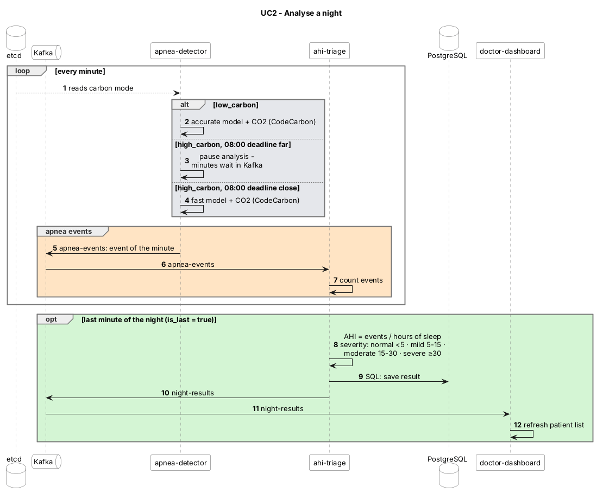

# UC2 – Analyse a night

Part of the [sequence diagram v2](../30.10_B_sequence-diagram_v2.md) (grey, orange and green blocks). Use cases overview: [README](../../README.md#use-cases). · Source (PlantUML): [10.11_A_UC2-analyse-a-night_v1.puml](10.11_A_UC2-analyse-a-night_v1.puml) · Image: [10.11_A_UC2-analyse-a-night_v1.png](10.11_A_UC2-analyse-a-night_v1.png)

| | |
| --- | --- |
| **Actor** | System |
| **Goal** | Find apnea events, calculate the AHI and the severity of the night, and measure the CO₂ of the analysis. |
| **Trigger** | A `raw-signals` message arrives (UC1). |
| **Precondition** | The model file `models/model.joblib` is in the detector image (ADR 0023); the carbon mode is set in etcd (UC5). |
| **Services** | `apnea-detector`, `ahi-triage`, `doctor-dashboard` |
| **Data** | etcd `carbon_mode` → Kafka `apnea-events` → Kafka `night-results` → PostgreSQL table `results` (owner A) |
| **Decisions** | ADR 0010, 0013, 0021, 0023, 0025, 0026 |

## Main flow
1. The `apnea-detector` reads the carbon mode from etcd (`low_carbon` / `high_carbon`).
2. It classifies the minute with the **accurate** or the **fast** model and measures the CO₂ with CodeCarbon.
3. It sends one `apnea-events` message per minute:
   `patient_id`, `night_id`, `minute`, `event` (apnea / hypopnea / none), `model` (fast / accurate), `carbon_mode`, `is_last`.
4. `ahi-triage` reads `apnea-events` and counts the events of the night.
5. When `is_last = true`, `ahi-triage` calculates the **AHI** = (apneas + hypopneas) / hours of sleep and the severity:
   normal < 5 · mild 5–15 · moderate 15–30 · severe ≥ 30 events per hour.
6. `ahi-triage` saves the result in `results` (`ahi`, `severity`, `apnea_count`, `hypopnea_count`, `models_used`).
7. `ahi-triage` sends `night-results` (`patient_id`, `night_id`, `ahi`, `severity`).
8. The `doctor-dashboard` reads `night-results` and refreshes the patient list (then UC4).

## Alternative flows
- **A1 – low_carbon:** accurate model.
- **A2 – high_carbon, 08:00 deadline far:** the analysis pauses; the minutes wait in Kafka (UC5).
- **A3 – high_carbon, 08:00 deadline close:** fast model, so the result is ready by 08:00.
- **A4 – `ahi-triage` restarts during the night:** it continues from its last Kafka offset.

## Postcondition
The night has a result with AHI and severity in `results`, and the dashboard shows it to the doctor.

## Sequence diagram (PlantUML)

