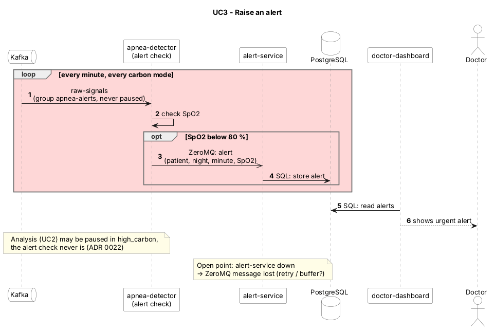

# UC3 – Raise an alert

Part of the [sequence diagram v2](../30.10_B_sequence-diagram_v2.md) (red block). Use cases overview: [README](../../README.md#use-cases). · Source (PlantUML): [10.11_A_UC3-raise-an-alert_v1.puml](10.11_A_UC3-raise-an-alert_v1.puml) · Image: [10.11_A_UC3-raise-an-alert_v1.png](10.11_A_UC3-raise-an-alert_v1.png)

| | |
| --- | --- |
| **Actors** | System, doctor |
| **Goal** | When SpO₂ drops below 80 %, the doctor sees an alert on the dashboard right away. Alerts never wait. |
| **Trigger** | A `raw-signals` minute with SpO₂ < 80 %. |
| **Precondition** | `alert-service` is running and listens on ZeroMQ. |
| **Services** | `apnea-detector` (alert check), `alert-service`, `doctor-dashboard` |
| **Data** | Kafka `raw-signals` → ZeroMQ `alert` → PostgreSQL table `alerts` (owner B) |
| **Decisions** | ADR 0009, 0022, 0025, 0026 |

## Main flow
1. The alert check in the `apnea-detector` reads `raw-signals` with its **own consumer group `apnea-alerts`**, which is never paused (ADR 0022).
2. Every minute it checks the SpO₂ values, in every carbon mode.
3. If SpO₂ < 80 %, it sends an `alert` over ZeroMQ: `patient_id`, `night_id`, `minute`, `spo2`.
4. The `alert-service` receives the alert and stores it in `alerts`.
5. The `doctor-dashboard` reads `alerts` and shows the alert to the doctor.

## Alternative flows
- **A1 – high_carbon:** the analysis (UC2) is paused, but the alert check still runs because it uses its own consumer group.
- **A2 – SpO₂ ≥ 80 %:** no alert, nothing is sent.
- **A3 – `alert-service` is down:** the ZeroMQ message is lost; the alert check logs it. *(Open point: retry or buffer.)*

## Postcondition
The alert is stored in `alerts` and visible on the dashboard, independent of the night analysis.

## Sequence diagram (PlantUML)

