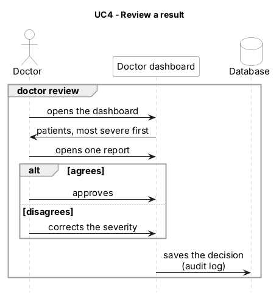

# UC4 – Review a result

Part of the [sequence diagram v2](../30.10_B_sequence-diagram_v2.md). Use cases overview: [README](../../README.md#use-cases). · Source (PlantUML): [10.11_A_UC4-review-a-result_v1.puml](10.11_A_UC4-review-a-result_v1.puml) · Image: [10.11_A_UC4-review-a-result_v1.png](10.11_A_UC4-review-a-result_v1.png)

| | |
| --- | --- |
| **Actor** | Doctor |
| **Goal** | The doctor checks each result and approves or corrects it. Every decision is logged. |
| **Trigger** | A new result is on the dashboard (end of UC2), or the doctor opens the dashboard. |
| **Precondition** | The night has a result in `results`. |
| **Services** | `doctor-dashboard` |
| **Data** | PostgreSQL tables `patients`, `raw_nights`, `results`, `alerts` (read) → `decisions` = audit log (owner A, written) |
| **Decisions** | ADR 0007, 0018, 0025 |

## Main flow
1. The doctor opens the dashboard (HTTP).
2. The dashboard reads patients, results, SpO₂ data and alerts from PostgreSQL.
3. It shows the patients **sorted by severity** (severe first).
4. The doctor opens a report: SpO₂ chart of the night, AHI, severity, alerts and model used.
5. The doctor approves the result.
6. The dashboard saves the decision in `decisions`: `night_id`, `action`, `final_severity`, `doctor`, `decided_at`.

## Alternative flows
- **A1 – The doctor disagrees:** they correct the severity; the decision is saved with `action = corrected` and the new `final_severity`.
- **A2 – A decision is changed later:** a new row is added to `decisions`; old rows are never changed (audit log).

## Out of scope
Login for doctors, sending the report to the patient (ADR 0018), history over several nights.

## Postcondition
Every result has at least one decision in `decisions`; the final severity is the doctor's.

## Sequence diagram (PlantUML)

