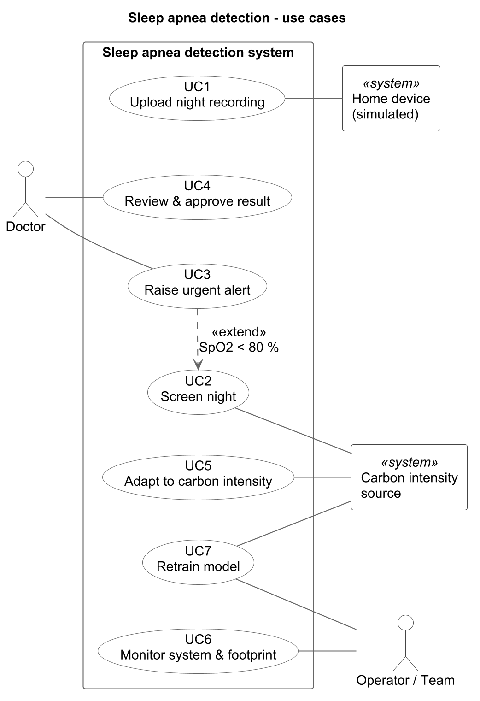

# Use case diagram

All use cases of the system and their actors. Source (PlantUML): [10.11_B_use-cases_v1.puml](10.11_B_use-cases_v1.puml) · Image: [10.11_B_use-cases_v1.png](10.11_B_use-cases_v1.png)

The description and the sequence diagram of each use case are in [`../sequences/`](../sequences/README.md). The short table is in the [README](../../README.md#use-cases).

| Actor | Use cases |
| --- | --- |
| Home device (simulated) | UC1 |
| Doctor | UC3, UC4 |
| Carbon intensity source | UC5 (primary), UC2, UC7 (secondary) |
| Operator / Team | UC6, UC7 |

- **UC3 `<<extend>>` UC2:** the urgent alert happens only when SpO₂ goes below 80 % during a night.
- People (Doctor, Operator / Team) are drawn as stick figures; external systems (Home device, Carbon intensity source) as boxes with `<<system>>`.
- The carbon-scheduler, Kafka and Kubernetes are not actors, they are part of the system.

