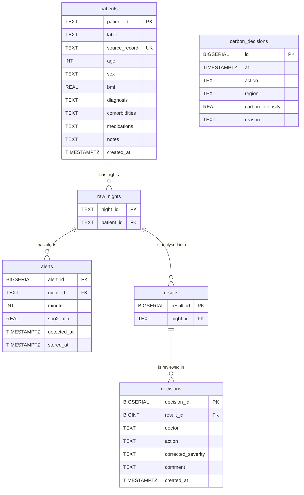

# Database – Aliénor's tables

Database `sleep_apnea` (PostgreSQL 16). The SQL files are in [`db/init/`](../db/init/) and run in number order when the database starts for the first time (see [ADR 0007](../ADR/0007-one-postgresql-database-with-table-ownership.md): one database, every table written by one service only).

This page describes only the tables and files owned by Aliénor:

| File | Table | Written by |
|---|---|---|
| `01_patients.sql` | `patients` | seed script (`patient_seed`) |
| `05_alerts.sql` | `alerts` | alert-service (`alert_service`) |
| `06_decisions.sql` | `decisions` | doctor-dashboard (`doctor_dashboard`) |
| `07_carbon_decisions.sql` | `carbon_decisions` | carbon-scheduler (`carbon_scheduler`) |
| `08_create_users.sql` | – (7 database users) | – |
| `09_insert_demo_patients.sql` | `patients` (5 demo rows) | – |

## Schema

Grey tables (`raw_nights`, `results`) belong to Barbara; they are shown because Aliénor's tables point to them.



`carbon_decisions` has no link to other tables.

### Types used

| PostgreSQL type | Simple type | Meaning |
|---|---|---|
| `TEXT` | string | text of any length |
| `INT` | integer | whole number |
| `BIGINT` | integer | big whole number (used to point to a `BIGSERIAL`) |
| `BIGSERIAL` | integer | big whole number, filled automatically 1, 2, 3 … |
| `REAL` | float | decimal number |
| `TIMESTAMPTZ` | datetime | date and time with time zone |

**PK** = primary key (unique id of the row) · **FK** = foreign key (points to a row in another table) · **UK** = unique

---

## `patients` – `01_patients.sql`

One row per (fictional) patient. Shown as the patient card on the night detail page of the dashboard.
GDPR: all data is fictional and pseudonymised – no real names, only `P01` … `P05`.

| Column | PostgreSQL type | Simple type | Required | Key / rule | Description |
|---|---|---|---|---|---|
| `patient_id` | `TEXT` | string | yes | **PK** | `P01` … `P05` |
| `label` | `TEXT` | string | yes | | name shown on the dashboard, e.g. `Patient 01` |
| `source_record` | `TEXT` | string | no | unique | PhysioNet record used for the nights, e.g. `ucddb018` |
| `age` | `INT` | integer | no | 0 – 120 | age in years |
| `sex` | `TEXT` | string | no | `F` or `M` | |
| `bmi` | `REAL` | float | no | 10 – 80 | body mass index |
| `diagnosis` | `TEXT` | string | no | | reason for referral |
| `comorbidities` | `TEXT` | string | no | | other illnesses |
| `medications` | `TEXT` | string | no | | |
| `notes` | `TEXT` | string | no | | e.g. Epworth score |
| `created_at` | `TIMESTAMPTZ` | datetime | no | default `now()` | when the row was written |

### Demo patients – `09_insert_demo_patients.sql`

| patient_id | source_record | age | sex | bmi | AHI of the real night |
|---|---|---|---|---|---|
| P01 | ucddb018 | 41 | F | 24.8 | 2.2 (normal) |
| P02 | ucddb017 | 52 | M | 28.9 | 12.0 (mild) |
| P03 | ucddb013 | 58 | F | 30.6 | 15.7 (moderate) |
| P04 | ucddb010 | 63 | M | 33.1 | 33.4 (severe) |
| P05 | ucddb025 | 49 | M | 36.4 | 94.1 (severe) |

Age, sex, BMI, diagnosis, comorbidities, medications and notes are invented. The signals and the AHI come from the real UCDDB night.

---

## `alerts` – `05_alerts.sql`

One row per urgent alert: SpO₂ went below 80 % (UC3). Written by the alert-service, never changed afterwards.

| Column | PostgreSQL type | Simple type | Required | Key / rule | Description |
|---|---|---|---|---|---|
| `alert_id` | `BIGSERIAL` | integer | yes | **PK**, automatic | |
| `night_id` | `TEXT` | string | yes | **FK** → `raw_nights.night_id` | the night of the alert |
| `minute` | `INT` | integer | yes | ≥ 0 | minute of the night |
| `spo2_min` | `REAL` | float | yes | 0 – 100 | lowest SpO₂ in that minute, % |
| `detected_at` | `TIMESTAMPTZ` | datetime | yes | | when the alert-check saw the drop |
| `stored_at` | `TIMESTAMPTZ` | datetime | no | default `now()` | when the row was written |

Index on `night_id` (the dashboard looks up the alerts of one night).
Alert latency for monitoring = `stored_at − detected_at` (must stay under 5 s).

> **Open point:** an alert happens during the night, but the `raw_nights` row may be written later (the apnea-detector can wait for low-carbon electricity). With the foreign key, such an alert is refused. To decide with Barbara: remove the foreign key, or write the `raw_nights` row at the first minute of the night.

---

## `decisions` – `06_decisions.sql`

Audit log of the doctor's review (UC4). Rows are only added, never changed or deleted.

| Column | PostgreSQL type | Simple type | Required | Key / rule | Description |
|---|---|---|---|---|---|
| `decision_id` | `BIGSERIAL` | integer | yes | **PK**, automatic | |
| `result_id` | `BIGINT` | integer | yes | **FK** → `results.result_id` | the reviewed result |
| `doctor` | `TEXT` | string | yes | | pseudonym, e.g. `dr_demo` |
| `action` | `TEXT` | string | yes | `approve` or `correct` | |
| `corrected_severity` | `TEXT` | string | see rule | `normal`, `mild`, `moderate`, `severe` | new severity, only for a correction |
| `comment` | `TEXT` | string | no | | |
| `created_at` | `TIMESTAMPTZ` | datetime | no | default `now()` | when the doctor decided |

Rule: `correct` **must** have a `corrected_severity`; `approve` **must not** have one.
Index on `result_id`.

---

## `carbon_decisions` – `07_carbon_decisions.sql`

Log of what the carbon-scheduler did and why (UC5). Rows are only added.

| Column | PostgreSQL type | Simple type | Required | Key / rule | Description |
|---|---|---|---|---|---|
| `id` | `BIGSERIAL` | integer | yes | **PK**, automatic | |
| `at` | `TIMESTAMPTZ` | datetime | yes | default `now()` | when the decision was taken |
| `action` | `TEXT` | string | yes | `pause`, `resume`, `move`, `scale` | what was done |
| `region` | `TEXT` | string | no | `AT`, `NO`, `PL` | target region (for `move`) |
| `carbon_intensity` | `REAL` | float | no | ≥ 0 | gCO₂/kWh at decision time |
| `reason` | `TEXT` | string | no | | e.g. `intensity 420 > 300, deadline in 6 h` |

Index on `at`.

---

## Database users – `08_create_users.sql`

One user per service. Every user can **read all tables** but **write only its own table**. No user can create tables.

| User | Writes to | Rights |
|---|---|---|
| `patient_seed` | `patients` | INSERT, UPDATE |
| `apnea_detector` | `raw_nights` | INSERT, UPDATE |
| `ahi_triage` | `results` | INSERT, UPDATE |
| `model_trainer` | `model_versions` | INSERT, UPDATE |
| `alert_service` | `alerts` | INSERT only |
| `doctor_dashboard` | `decisions` | INSERT only (audit log) |
| `carbon_scheduler` | `carbon_decisions` | INSERT only |

Passwords are `dev_<user>` (e.g. `dev_alert_service`) for local development only. In Kubernetes they come from Secrets.

---

## Check it yourself

```powershell
docker compose up -d
docker compose exec postgres psql -U postgres -d sleep_apnea -c "\d patients"
```
`\d <table>` shows the columns and types of a table, `\dt` lists all tables, `\du` lists the users. Or open [`db/explore_db.ipynb`](../db/explore_db.ipynb).
