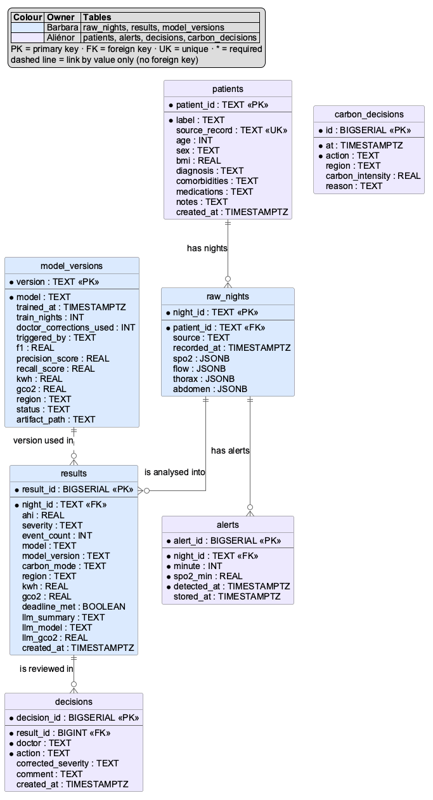

# Database 

Database `sleep_apnea` (PostgreSQL 16). The SQL files are in [`db/init/`](../db/init/) and run in number order when the database starts for the first time (see [ADR 0007](../ADR/0007-one-postgresql-database-with-table-ownership.md): one database, every table written by one service only).

This page describes all tables and who owns them:

| File | Table | Written by | Owner |
|---|---|---|---|
| `01_patients.sql` | `patients` | seed script (`patient_seed`) | Aliénor |
| `02_raw_nights.sql` | `raw_nights` | apnea-detector (`apnea_detector`) | Barbara |
| `03_results.sql` | `results` | ahi-triage (`ahi_triage`) | Barbara |
| `04_model_versions.sql` | `model_versions` | model-trainer (`model_trainer`) | Barbara |
| `05_alerts.sql` | `alerts` | alert-service (`alert_service`) | Aliénor |
| `06_decisions.sql` | `decisions` | doctor-dashboard (`doctor_dashboard`) | Aliénor |
| `07_carbon_decisions.sql` | `carbon_decisions` | carbon-scheduler (`carbon_scheduler`) | Aliénor |
| `08_create_users.sql` | – (7 database users) | – | Aliénor |
| `09_insert_demo_patients.sql` | `patients` (5 demo rows) | – | Aliénor |

## Schema

Source (PlantUML): [21.11_B_database-schema_v1.puml](../diagrams/db_schema/21.11_B_database-schema_v1.puml) · Image: [21.11_B_database-schema_v1.png](../diagrams/db_schema/21.11_B_database-schema_v1.png)



`carbon_decisions` has no link to other tables. The dashed line `model_versions` → `results` is a link by value only: `results.model_version` holds the same text as `model_versions.version`, but there is no foreign key.

### Types used

| PostgreSQL type | Simple type | Meaning |
|---|---|---|
| `TEXT` | string | text of any length |
| `INT` | integer | whole number |
| `BIGINT` | integer | big whole number (used to point to a `BIGSERIAL`) |
| `BIGSERIAL` | integer | big whole number, filled automatically 1, 2, 3 … |
| `REAL` | float | decimal number |
| `BOOLEAN` | boolean | `true` or `false` |
| `JSONB` | JSON | JSON value stored in binary form (here: an array of numbers) |
| `TIMESTAMPTZ` | datetime | date and time with time zone |

**PK** = primary key (unique id of the row) · **FK** = foreign key (points to a row in another table) · **UK** = unique

---

## `patients` – `01_patients.sql`

One row per (fictional) patient. Shown as the patient card on the night detail page of the dashboard.
GDPR: all data is fictional and pseudonymised – no real names, only `P01` … `P05`.

| Column | PostgreSQL type | Simple type | Required | Key / rule | Description |
|---|---|---|---|---|---|
| `patient_id` | `TEXT` | string | yes | **PK** | `P01` … `P05` |
| `label` | `TEXT` | string | yes | | name shown on the dashboard, e.g. `Patient 01` |
| `source_record` | `TEXT` | string | no | unique | PhysioNet record used for the nights, e.g. `ucddb018` |
| `age` | `INT` | integer | no | 0 – 120 | age in years |
| `sex` | `TEXT` | string | no | `F` or `M` | |
| `bmi` | `REAL` | float | no | 10 – 80 | body mass index |
| `diagnosis` | `TEXT` | string | no | | reason for referral |
| `comorbidities` | `TEXT` | string | no | | other illnesses |
| `medications` | `TEXT` | string | no | | |
| `notes` | `TEXT` | string | no | | e.g. Epworth score |
| `created_at` | `TIMESTAMPTZ` | datetime | no | default `now()` | when the row was written |

### Demo patients – `09_insert_demo_patients.sql`

| patient_id | source_record | age | sex | bmi | AHI of the real night |
|---|---|---|---|---|---|
| P01 | ucddb018 | 41 | F | 24.8 | 2.2 (normal) |
| P02 | ucddb017 | 52 | M | 28.9 | 12.0 (mild) |
| P03 | ucddb013 | 58 | F | 30.6 | 15.7 (moderate) |
| P04 | ucddb010 | 63 | M | 33.1 | 33.4 (severe) |
| P05 | ucddb025 | 49 | M | 36.4 | 94.1 (severe) |

Age, sex, BMI, diagnosis, comorbidities, medications and notes are invented. The signals and the AHI come from the real UCDDB night.

---

## `raw_nights` – `02_raw_nights.sql`

One row per recorded night. The apnea-detector creates the row at the first minute and adds every minute as it arrives (UC2), so the dashboard can draw the SpO₂ chart and the night can be analysed again later.

| Column | PostgreSQL type | Simple type | Required | Key / rule | Description |
|---|---|---|---|---|---|
| `night_id` | `TEXT` | string | yes | **PK** | id of the night, e.g. `ucddb013` |
| `patient_id` | `TEXT` | string | yes | **FK** → `patients.patient_id` | the patient of the night |
| `source` | `TEXT` | string | no | `ucddb` or `apnea-ecg` | PhysioNet dataset the signals come from |
| `recorded_at` | `TIMESTAMPTZ` | datetime | no | default `now()` | when the row was written |
| `spo2` | `JSONB` | JSON array of floats | no | must be an array | SpO₂ of the whole night, 1 Hz, % |
| `flow` | `JSONB` | JSON array of floats | no | must be an array | nasal airflow, 4 Hz |
| `thorax` | `JSONB` | JSON array of floats | no | must be an array | chest movement, 4 Hz |
| `abdomen` | `JSONB` | JSON array of floats | no | must be an array | belly movement, 4 Hz |

Index on `patient_id` (the dashboard looks up all nights of one patient).
Size: an 8 h night at 4 Hz is about 115 000 values per signal, stored in one row.

---

## `results` – `03_results.sql`

One row per analysed night: AHI and severity for the doctor, plus how the analysis ran and how much CO₂ it cost (UC2, UC5). Written by ahi-triage; the doctor's review of a result goes to `decisions`.

| Column | PostgreSQL type | Simple type | Required | Key / rule | Description |
|---|---|---|---|---|---|
| `result_id` | `BIGSERIAL` | integer | yes | **PK**, automatic | |
| `night_id` | `TEXT` | string | yes | **FK** → `raw_nights.night_id` | the analysed night |
| `ahi` | `REAL` | float | no | ≥ 0 | apnea-hypopnea index, events per hour of sleep |
| `severity` | `TEXT` | string | no | `normal`, `mild`, `moderate`, `severe` | from the AHI: < 5 / 5–15 / 15–30 / ≥ 30 |
| `event_count` | `INT` | integer | no | ≥ 0 | number of apnea events in the night |
| `model` | `TEXT` | string | no | `fast` or `accurate` | which model ran (chosen by the carbon mode) |
| `model_version` | `TEXT` | string | no | same text as `model_versions.version` | e.g. `accurate-v3` |
| `carbon_mode` | `TEXT` | string | no | `low_carbon` or `high_carbon` | carbon mode at analysis time |
| `region` | `TEXT` | string | no | `AT`, `NO`, `PL` | where the analysis ran |
| `kwh` | `REAL` | float | no | ≥ 0 | energy of the analysis (CodeCarbon) |
| `gco2` | `REAL` | float | no | ≥ 0 | CO₂ of the analysis in grams (CodeCarbon) |
| `deadline_met` | `BOOLEAN` | boolean | no | | `true` if the result was ready before 08:00 |
| `llm_summary` | `TEXT` | string | no | | short text summary for the doctor, written by the LLM |
| `llm_model` | `TEXT` | string | no | | which LLM wrote the summary |
| `llm_gco2` | `REAL` | float | no | ≥ 0 | CO₂ of the LLM call in grams |
| `created_at` | `TIMESTAMPTZ` | datetime | no | default `now()` | when the row was written |

Index on `night_id` (the dashboard looks up the result of one night).
Total CO₂ of one night = `gco2 + llm_gco2`.
Same values as the `night-results` Kafka message ([`kafka/schemas/night-results-value.schema.json`](../kafka/schemas/night-results-value.schema.json)).

---

## `model_versions` – `04_model_versions.sql`

One row per trained model (UC7). Written by the model-trainer Job; GitHub Actions deploys a version only if its F1 is above our threshold (F1 gate, [ADR 0005](../ADR/0005-model-lifecycle-carbon-aware-retraining.md)).

| Column | PostgreSQL type | Simple type | Required | Key / rule | Description |
|---|---|---|---|---|---|
| `version` | `TEXT` | string | yes | **PK** | e.g. `accurate-v3`; `results.model_version` uses the same text |
| `model` | `TEXT` | string | yes | `fast` or `accurate` | |
| `trained_at` | `TIMESTAMPTZ` | datetime | no | default `now()` | when the training finished |
| `train_nights` | `INT` | integer | no | ≥ 0 | how many nights were used for training |
| `doctor_corrections_used` | `INT` | integer | no | ≥ 0 | how many doctor corrections (`decisions` with `action = correct`) were used for training |
| `triggered_by` | `TEXT` | string | no | `schedule`, `manual`, `drift` | what started the training: weekly CronJob, the team, or monitoring (model drift) |
| `f1` | `REAL` | float | no | 0 – 1 | F1 score on the held-out Apnea-ECG nights |
| `precision_score` | `REAL` | float | no | 0 – 1 | precision on the same nights |
| `recall_score` | `REAL` | float | no | 0 – 1 | recall on the same nights |
| `kwh` | `REAL` | float | no | ≥ 0 | energy of the training (CodeCarbon) |
| `gco2` | `REAL` | float | no | ≥ 0 | CO₂ of the training in grams (CodeCarbon) |
| `region` | `TEXT` | string | no | `AT`, `NO`, `PL` | where the training ran |
| `status` | `TEXT` | string | no | `pending`, `approved`, `rejected`; default `pending` | result of the F1 gate in CI/CD |
| `artifact_path` | `TEXT` | string | no | | where the model file is stored |

Life of a row: the trainer writes it with `status = pending` → CI/CD checks F1 → `approved` (deployed) or `rejected`.

---

## `alerts` – `05_alerts.sql`

One row per urgent alert: SpO₂ went below 80 % (UC3). Written by the alert-service, never changed afterwards.

| Column | PostgreSQL type | Simple type | Required | Key / rule | Description |
|---|---|---|---|---|---|
| `alert_id` | `BIGSERIAL` | integer | yes | **PK**, automatic | |
| `night_id` | `TEXT` | string | yes | **FK** → `raw_nights.night_id` | the night of the alert |
| `minute` | `INT` | integer | yes | ≥ 0 | minute of the night |
| `spo2_min` | `REAL` | float | yes | 0 – 100 | lowest SpO₂ in that minute, % |
| `detected_at` | `TIMESTAMPTZ` | datetime | yes | | when the alert-check saw the drop |
| `stored_at` | `TIMESTAMPTZ` | datetime | no | default `now()` | when the row was written |

Index on `night_id` (the dashboard looks up the alerts of one night).
Alert latency for monitoring = `stored_at − detected_at` (must stay under 5 s).

> **Solved:** the apnea-detector writes the `raw_nights` row at the **first minute** of the night, in its alert path that is never paused, before it sends any alert of that night. So the foreign key stays.

---

## `decisions` – `06_decisions.sql`

Audit log of the doctor's review (UC4). Rows are only added, never changed or deleted.

| Column | PostgreSQL type | Simple type | Required | Key / rule | Description |
|---|---|---|---|---|---|
| `decision_id` | `BIGSERIAL` | integer | yes | **PK**, automatic | |
| `result_id` | `BIGINT` | integer | yes | **FK** → `results.result_id` | the reviewed result |
| `doctor` | `TEXT` | string | yes | | pseudonym, e.g. `dr_demo` |
| `action` | `TEXT` | string | yes | `approve` or `correct` | |
| `corrected_severity` | `TEXT` | string | see rule | `normal`, `mild`, `moderate`, `severe` | new severity, only for a correction |
| `comment` | `TEXT` | string | no | | |
| `created_at` | `TIMESTAMPTZ` | datetime | no | default `now()` | when the doctor decided |

Rule: `correct` **must** have a `corrected_severity`; `approve` **must not** have one.
Index on `result_id`.

---

## `carbon_decisions` – `07_carbon_decisions.sql`

Log of what the carbon-scheduler did and why (UC5). Rows are only added.

| Column | PostgreSQL type | Simple type | Required | Key / rule | Description |
|---|---|---|---|---|---|
| `id` | `BIGSERIAL` | integer | yes | **PK**, automatic | |
| `at` | `TIMESTAMPTZ` | datetime | yes | default `now()` | when the decision was taken |
| `action` | `TEXT` | string | yes | `pause`, `resume`, `move`, `scale` | what was done |
| `region` | `TEXT` | string | no | `AT`, `NO`, `PL` | target region (for `move`) |
| `carbon_intensity` | `REAL` | float | no | ≥ 0 | gCO₂/kWh at decision time |
| `reason` | `TEXT` | string | no | | e.g. `intensity 420 > 300, deadline in 6 h` |

Index on `at`.

---

## Database users – `08_create_users.sql`

One user per service. Every user can **read all tables** but **write only its own table**. No user can create tables.

| User | Writes to | Rights |
|---|---|---|
| `patient_seed` | `patients` | INSERT, UPDATE |
| `apnea_detector` | `raw_nights` | INSERT, UPDATE |
| `ahi_triage` | `results` | INSERT, UPDATE |
| `model_trainer` | `model_versions` | INSERT, UPDATE |
| `alert_service` | `alerts` | INSERT only |
| `doctor_dashboard` | `decisions` | INSERT only (audit log) |
| `carbon_scheduler` | `carbon_decisions` | INSERT only |

Passwords are `dev_<user>` (e.g. `dev_alert_service`) for local development only. In Kubernetes they come from Secrets.

---

## Check it yourself

```powershell
docker compose up -d
docker compose exec postgres psql -U postgres -d sleep_apnea -c "\d patients"
```
`\d <table>` shows the columns and types of a table, `\dt` lists all tables, `\du` lists the users. Or open [`db/explore_db.ipynb`](../db/explore_db.ipynb).
